# 基于几何约束的多视图二维设计向复杂三维模型表面的高保真纹理转译技术

> **OrthoTex（Geometry-Guided Texture Transfer）** ｜ 问题定义与方案设计
>
> 作者：AvroraCL ｜ 版本：v2.0 ｜ 更新：2026-10-16
> 原始来源：<https://avroracl.github.io/geo-guided-texture-transfer/paper/index.html>
>
> **本文由 `paper/index.html` 自动派生，请勿直接编辑本文件。**
> 修改正文请改 HTML，然后运行 `python tools/build-md.py`。
>
> 状态：方案设计阶段。未实现、未验证。正文中 `[假设]` 为待验证推断，`[待补]` 为缺失信息，
> 均不构成结论。全文插图均为概念示意图，不具备证据价值。

---

## 摘要

在游戏外观模改的实际生产中，多视图二维设计稿（正交视图）向三维模型表面贴图的转换，至今仍高度依赖人工。图像生成模型已能产出高质量的设计参考与素材，大语言模型已能将模糊的自然语言需求转译为结构化设计意图，但二者均无法完成从**外观分布**到**UV 空间对应**这一环节，即参考图上"长这样"的图案究竟对应模型表面哪一位置、跨过 UV 接缝后应如何接续。

本文提出，该环节构成一个独立且当前未被充分解决的**中间层问题**。其难点不在投影——投影已有成熟工具——而在**延续**：多视图天然存在信息缺口，背面、凹陷与自遮挡区域缺乏设计信息，图案必须被合理推演填充。本文结合游戏资产生产的六条硬约束，给出该中间层的输入输出契约、三个子问题的分解、三条候选技术路线及其取舍，并设计相应的验证方案。**其中两项验证已完成执行：实测三视图对飞机本体的覆盖率为 80.39%；并证明了跨 UV 接缝的图案错位并非由投影造成——需要补全的是表面中根本不存在设计信息的部分。两项结果使研究方向收敛为一条：未覆盖区域的补全是否可行**。本文不提出新的生成模型。

**关键词：** 纹理转译；UV 空间；接缝连续性；多视图设计稿；游戏资产生产；中间层

> **写给谁看**
>
> 本文面向熟悉 PBR 流程、但不熟悉图形算法与人工智能的美术从业者。UV、接缝、通道这些你们比我熟，本文不解释；反过来，**凡涉及算法与模型的部分，本文一律先给类比，再给术语，并尽量配图**。
>
> 若只关心"哪些能做、哪些不能做、我该怎么安排手上的活"，可直接跳读第 4 章与第 7 章。
>
> 本文由作者与人工智能助手协作完成，具体分工见文末「关于本文的撰写方式」。

## 使用 AI 阅读与研究

本文同时欢迎人类与 AI 的贡献。你可以把本文交给任意 AI 助手（ChatGPT、Claude、Gemini、DeepSeek 等）——不绑定任何厂商，也不需要注册额外账号。选择一种模式，复制提示词，粘贴给你的 AI。

### 一、理解研究

按你的专业背景解释本文，把概念与真实设计工作流联系起来，并区分文献结论、作者经验与未验证假设。

      复制提示词

### 二、批判性审查

要求 AI 独立审查，不默认作者正确：检查定义与推导、寻找反例、核查引用、指出不具备创新性的假设。

      复制提示词

### 三、参与研究

让具备检索、推导或编程能力的 AI 主动参与：比较文献、设计可证伪假设、构建最小实验、提出反例。

      复制提示词

This research is open to both human and AI contributions. We welcome new ideas, reproducible experiments, critical reviews, and even evidence that challenges our current assumptions. 本研究同时欢迎人类与 AI 的贡献。我们欢迎新思路、可复现实验、批判性审查，以及任何能够挑战现有假设的证据。

[切换深色 / 浅色](#) [Markdown 原文](https://github.com/AvroraCL/geo-guided-texture-transfer/blob/main/paper/full.md) [研究上下文](https://github.com/AvroraCL/geo-guided-texture-transfer/blob/main/paper/context.md) [公开研究问题](https://github.com/AvroraCL/geo-guided-texture-transfer/blob/main/research/open-questions.md) [假设与证据状态](https://github.com/AvroraCL/geo-guided-texture-transfer/blob/main/research/hypotheses.md) [贡献指南](https://github.com/AvroraCL/geo-guided-texture-transfer/blob/main/CONTRIBUTING.md) [Issues](https://github.com/AvroraCL/geo-guided-texture-transfer/issues)

## 1 问题的提出

### 1.1 实践背景：一条已经半自动化的流水线

当前一套成熟的游戏外观模改流程大致如下 [已核对]（据作者自身实践）：

1. 在 Blender 中整理与修复模型，并渲染若干**正交视图**作为绘制底稿；
2. 在 Photoshop 等二维软件中依据正交视图绘制设计稿与素材；
3. 在 Substance Painter 中于三维空间直接绘制，产出符合 PBR 规范的多通道贴图；
4. 导出并导入游戏，验证效果后迭代修正。

其中已引入人工智能的环节包括抠图、素材生成与参考图生成。图像生成模型配合有经验的设计师，已能产出可用的设计参考 [已核对]。


*图 1 现有生产链条与缺失环节。首尾两端均有成熟方案，中间一环缺失。*

### 1.2 断层所在：外观分布不等于空间对应

有一个容易混淆之处需要先行澄清。视觉模型对参考图所进行的处理，更准确的表述是**条件注入**，而非"理解三维结构"：结构控制 [7]、风格控制与参考图注入 [8] 等机制所对齐的是**外观分布**，即"这张图应当长成什么样"；它们并不建立**空间对应**，即"这一纹样对应模型表面哪一具体位置、跨过接缝后接到何处"。

而中间层所需要的恰恰是后者。这解释了为何单纯提升生成模型的能力无法自动补齐该环节：它不是分辨率问题，也不是语义理解问题，而是**空间结构的错配**。

> **核心论断**
>
> UV 空间与图像空间的拓扑结构并不一致：UV 图上紧邻的两块，在三维模型上可能相隔很远；三维模型上连续的一片，在 UV 图上可能分属互不相连的岛屿。因此，视觉信息必须被**在两个拓扑结构不同的空间之间搬运**，而不能简单地投影或复制。三者（三维表面、UV 空间、投影图像）的严格区分见 2.1 节。

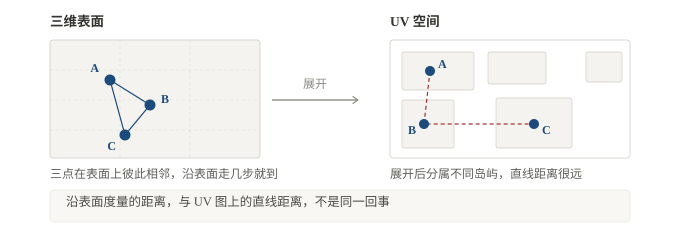

*图 2 三维表面与 UV 空间的拓扑错配。实线为表面上的邻接，虚线为 UV 上的距离。*

理解上述论断，还有一个前置问题需要先讲清楚：**计算机里有两种完全不同的活，一种叫"算"，一种叫"猜"**。这是全文最需要区分的一件事，后面所有的分工判断都由它决定。


*图 3 "算"与"猜"的区别。前者输出唯一且可校验，后者输出多样且难以验证。*

### 1.3 硬约束清单

以下约束来自游戏资产生产的实际需求，而非算法偏好。[假设] 它们构成本问题区别于一般纹理生成研究的根本原因，但此判断系由单一从业者的实践归纳，尚待交叉验证。

**表 1 游戏资产生产对纹理转译的硬约束**

| 编号 | 约束 | 含义 | 对方案的排除效果 |
|---|---|---|---|
| C1 | UV 不可重排 | 数十万面量级的 UV 一旦重排，将牵连法线烘焙、LOD 与平台规范，代价不可接受 | 排除"重新参数化为整块"的路线 |
| C2 | 规模 | 面数达数十万，任何需要逐面人工介入的方案都不可行 | 要求全流程自动 |
| C3 | 规范 | 贴图尺寸、通道构成、命名与格式由平台规定 | 输出必须可被规范校验 |
| C4 | 可编辑 | 结果须交回美术继续修改，不能是不可拆解的黑箱产物 | 排除纯端到端且不可回改的方案 |
| C5 | 接缝不可见 | 跨接缝处不得出现可见断裂、错位或拉伸突变 | 接缝处理是一等公民，而非后处理 |
| C6 | 无空洞 | 未被视图覆盖的表面必须有合理延续，不得留空或留噪点 | 必须具备推演与补全机制 |

### 1.4 研究问题

- **RQ1（对应）**：能否在既定 UV 拓扑下，建立设计稿像素与 UV 位置之间稳定、可计算的对应关系？
- **RQ2（延续）**：对多视图未覆盖的表面，能否生成在视觉与语义上均可接受的图案延续，且其质量可被度量？
- **RQ3（合规）**：上述过程能否在 C1 至 C6 全部约束下完成，且结果保持可编辑？

### 1.5 本文定位与贡献声明

本文**不提出新的生成模型**，亦不声称改进了任何现有算法。所调用的视觉生成模型、几何处理与渲染工具均为外部既有组件。本文的工作限于以下四项：

1. 将该工程断层**界定**为一个可研究的问题，并给出其形式化描述；
2. 给出该问题的**硬约束清单**与输入输出契约；
3. 梳理**设计空间**，列出候选路线并分析其取舍；
4. 设计验证方案，**并完成其中两项的执行**（覆盖率与跨接缝误差，见 5.2 节）。

第 5.2 节记录的两项实验已验证一项假设、否证另一项，并据此调整了后续方向。

## 2 相关工作

本章按**研究性质**组织，而不按技术路线：确定性纹理映射、曲面参数化与接缝布局、局部图案映射与贴花、生成式纹理生成、纹理重建、几何处理，六类分开讨论。这样划分的原因是，不同性质的工作其结论的可信程度并不相同——确定性算法的结果可复现、可校验，生成式方法则不然，混在一起谈容易高估后者的可靠性。在此之前，先解释三个会反复出现的概念。

[待补] **关于本章描述的可靠性**：各文献的出处（作者、年份、发表处、DOI）均经外部数据库核对，但**对具体做法的描述系依据标题、摘要与公开信息整理，未逐篇通读全文**。凡涉及实现细节的判断，应以原文为准；在本文进入正式研究阶段前，相关段落需逐篇复核。

### 2.1 三个需要先讲清的概念

#### 沿表面走的距离

两点之间怎么算远近？平时量的是直线——拿尺子一拉，穿过空气。但在物体表面上，"近不近"要看**沿着表面走多久**。拿一只碗来说，碗口对边的两点，直线一跨就到；可要是只允许贴着碗面走，就得绕下碗底再爬上来，远出好几倍。

后文统一称它为**测地距离**。为什么非要在意它？因为判断"谁跟谁真的挨着"只能靠它——直线距离会骗人，穿过空气的那种近不算近。

在网格上把它算出来有两类成熟做法：一类把最短路径当作波前逐点推进，直接算出距离场（快速行进法 [5]）；另一类借热传导来求，先让热量在表面上扩散，再据温度场反推距离，速度更快（热方法 [6]）。两者都已相当成熟，本身不是本文要解决的问题——本文只借用它的结果。

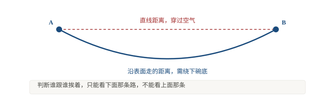

*图 4 直线距离与沿表面距离的差异。前者穿过空气，后者贴合表面。*

#### 模型拿到的，和它不知道的

第二个概念解释生成模型为什么需要额外帮助。模型拿到的是一张平面图，对它而言只是一堆格子上的数值；它并不知道这些格子对应模型表面的哪一块、朝向哪边。好比有人递给你一张印好的贴纸，却没告诉你该往哪个面贴。

近年的方法（[4]）做的正是补上这段缺失的对应关系：一边生成贴图，一边告知模型"你正在画的这一块，是模型的哪个位置、朝哪个方向"。后文称之为**表面感知的位置信息**。第 3.5 节讨论的接缝权重，本质上也属于这一类信息。

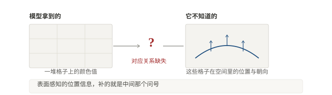

*图 5 模型实际掌握的信息与其缺失的对应关系。后者须由外部补充，无法由模型自行推断。*

#### 三种空间，三种邻接

后文会反复出现"邻接"这个词，但它其实指三种完全不同的东西，必须分开。

**其一，三维模型表面的拓扑邻接。**两个面片在网格上共享一条边，即为邻接。这是几何事实，与 UV 如何展开无关，也与相机在哪无关。

**其二，UV 参数化空间中的邻接。**两个纹素在贴图平面上相邻。这取决于 UV 是怎么展开的——同一条三维边可能被切开，在 UV 图上变成两条相隔很远的边。

**其三，正交投影图像中的二维邻接。**两个像素在设计稿上相邻。这取决于投影方向与遮挡关系——三维上相邻的两处，在某一视图里可能一前一后，中间隔着别的面片。

三者的关系可以这样概括：**三维邻接是事实，另外两者是它在不同参数化下的像，且都不是单射**——三维上一点，可以对应多个 UV 位置与多个投影像素；反过来，UV 上或图像上相邻的两处，未必在三维上相邻。

这里有一个常见误解需要澄清：**UV 岛在纹理空间中不连续，并不意味着对应的三维表面关系不可计算。**恰恰相反——正因为三维邻接是唯一确定的事实，跨 UV 岛的表面关系完全可以、也应当由几何算法直接算出，沿表面度量距离即是手段之一 [5][6]。UV 的断裂是参数化造成的表象，不是几何上的真实分离。把这两者混为一谈，会导致一个错误结论：以为跨接缝的图案连续性是"无法求解"的。

投影邻接则更弱：它同时受视角与遮挡影响，且设计稿通常不附相机参数。因此它只能作为初始对应的来源，不能作为连续性的判据。

### 2.2 确定性纹理映射：多视图投影路线

把多张照片或视图映射到三维表面，是一条有三十年历史的成熟路线。Debevec 等 [9] 在 1996 年就给出了从照片重建建筑几何并映射纹理的完整流程，其中已经处理了视图选择与接缝问题。此后这条路线持续演化：Lempitsky 与 Ivanov [10] 用马尔可夫随机场为每个面片挑选最优源视图，并专门处理相邻面片之间的可见接缝；Allene 等 [11] 引入多频段混合进一步柔化接缝；Waechter 等 [12] 把该思路扩展到数百万面片规模，成为工业级摄影测量软件的常用方案。

这一类的共同特点是**全部由确定性算法构成**：视图选择、可见性判定、投影、加权融合，每一步都有确定结果，可复现、可校验。它们不生成任何新内容，只在已有视图之间做选择与融合。

但它有一条根本边界：**只能处理被视图覆盖的部分**。未被任何视图覆盖的表面，这类方法一律留空或标记为无效，交由其他手段处理。本文面对的问题恰从这里开始——AI 生成的设计稿同样只覆盖部分表面，剩余部分没有任何确定性依据可用。

### 2.3 曲面参数化与接缝布局

参数化的任务是把三维曲面摊平到平面，同时尽量少产生畸变。这是一个成熟且庞大的方向，Sheffer 等 [19] 的综述给出了完整图景。与本文直接相关的是其中两个子问题：**在哪里切开**，以及**切开的边界如何布置**。

切开位置直接决定畸变大小。Lévy 等 [16] 的最小二乘共形映射给出了在给定切割下求解低畸变参数化的经典方法；Sorkine 等 [14] 的分片参数化则把切割本身作为优化变量，以贪心方式逐条增加割缝直到畸变低于阈值——这正是 UniTex 所用 GreedyCut 的来源。

接缝边界本身的布置也被专门研究过。Sheffer 与 Hart [13] 的 Seamster 把割缝布局当作独立问题：在保证低畸变的前提下，让割缝尽量落在不易察觉的位置。这一目标与本文关心的"图案不应被割缝切断"相近，但着眼点不同——它优化的是几何畸变与视觉隐蔽性，不涉及设计稿的内容。

此外，纹理图集的接缝连续性也有专门处理。Purnomo 等 [20] 指出，即便参数化本身畸变很低，图集内不同图块在接缝处仍会因采样不一致而出现可见缝；他们的做法是在接缝两侧建立共享的参数化，使跨缝采样自然连续。这一思路与本文 3.5 节将要讨论的问题直接相关。

### 2.4 局部图案映射与贴花

与处理整张贴图不同，还有一类工作专门处理"把一小块图案贴到曲面上"。Lévy [17] 的约束纹理映射允许用户指定若干对应点，据此求解满足这些约束的参数化；Soler 等 [15] 的分层图案映射用局部仿射近似，把图案以低畸变方式铺到曲面上。

与本文最接近的是 Schmidt 等 [18] 的贴花合成：它用离散指数映射把一小块贴花以近似等距的方式贴到曲面上，使图案在贴附后基本不被拉伸。这类方法在游戏与影视的贴花（decal）流程中被广泛使用。

这一类工作的适用条件是**图案局部且位置已知**——用户已经知道这块图案该贴在哪里。本文面对的情形更麻烦：设计稿是整张的、覆盖多个视图的，而且它与模型表面的对应关系本身就是待求量。

### 2.5 生成式纹理生成

近年出现了直接用生成模型产出纹理的路线，其中两项与本文关系最紧。

**Im2SurfTex** [2] 走的是最直接的一条路：先让二维图像模型绕着物体生成一组多视角图像，再把这些图像聚合到物体的纹理空间。关键在于"聚合"这一步。传统做法是把每张视图按相机参数反投影到表面，重叠处直接取平均，这样会在接缝与遮挡边界留下明显瑕疵；Im2SurfTex 的改进是训练一个神经模块来做聚合，并给每个像素编码其对应的三维位置、法向，以及面片内的测地距离。这条路线的根本限制在于它依赖多视角图像本身：图像模型没有生成、或生成质量不佳的视角，聚合结果便无从谈起；多视角之间天然存在的遮挡与视角不一致，也始终是它的负担。

**DirectUV** [4] 干脆绕开三维空间，直接在 UV 图上生成纹理。但直接在 UV 空间工作会碰到一个麻烦：UV 图上的坐标只是格子位置，并不等于模型表面的位置（见 2.1 节）。它的解法是给位置编码加入表面信息，让注意力绑定到表面几何而非 UV 格子。其摘要中有一句值得原样引用：这种错配**"限制了跨接缝与不连通 UV 岛之间的一致性"**。

两项工作的目标函数都是视觉质量，且都以"生成"为手段——它们可以产出好看的纹理，但不保证输出符合任何生产规范，也不提供逐元素的编辑接口。

### 2.6 纹理重建与整块化

UniTex [1] 从多视角照片重建贴图，走的是与本文**相反**的一条路：它重新参数化网格，把原本碎裂的 UV 整理成整块（single-chart），从根上消除接缝。需要说明的是，消除 UV 接缝并不等于消除全部畸变——论文自身也指出单图集仍会引入几何畸变，只是把问题从"缝"转移到了"形变"。

它的另一项工作是把光照与材质解耦——通过物理可微渲染，把拍摄时光照的影响从贴图里剥离出来，只留下材质本身。这一点对本文有直接参考价值，因为本文所处理的 AI 生成概念图同样自带光照。

本文不采用这条路线，原因见 1.3 节的约束 C1：重新参数化需要改动既定 UV，而游戏模型的 UV 牵连着法线烘焙、LOD 与平台规范，代价不可接受。

### 2.7 几何处理：曲线嵌入

与前述各条路线都不同，Robust Curve Embedding [3] 处理的不是贴图，也不是参数化，而是**曲线**——设计稿里的线条、轮廓与纹样边界。

它的做法是把每条边表示为代理网格上的测地路径，并在 UV 接缝处精确切分，从而精确复现图块边界。该工作明确以纹理迁移为应用场景，且专门处理"脏"网格：面片混乱、自相交、拼接不一致的网格，也就是游戏模型的常见状态。其结果比以往只能靠启发式缓解畸变的做法干净得多，实验显示接缝瑕疵被消除，高畸变离群值也明显减少。

它属于**确定性几何处理**：输入输出都是几何量，结果可复现、可校验，不含任何生成成分。但它只处理曲线，不涉及整张贴图的内容生成与补全。

### 2.8 分类汇总与本文位置

把上述工作按性质归拢，可以看出清晰的分界。

**表 2 六类相关工作及其边界**

| 类别 | 代表工作 | 解决的问题 | 不解决的 |
|---|---|---|---|
| 确定性纹理映射 | Debevec [9]；Lempitsky & Ivanov [10]；Allene [11]；Waechter [12] | 视图选择、投影与融合，以及相邻面片间的可见接缝 | 未被任何视图覆盖的表面 |
| 参数化与接缝布局 | Lévy [16]；Sorkine [14]；Sheffer & Hart [13]；Sheffer [19] | 低畸变摊平；割缝位置与边界布置 | 割缝与设计内容的关系；设计稿的对应 |
| 图集接缝连续性 | Purnomo [20] | 图块间因采样不一致产生的可见缝 | 内容层面的图案延续 |
| 局部图案映射与贴花 | Soler [15]；Lévy [17]；Schmidt [18] | 把一小块图案低畸变地贴到曲面上 | 整张设计稿；未知对应关系 |
| 生成式纹理生成 | Im2SurfTex [2]；DirectUV [4] | 在缺乏完整观测时产出视觉合理的纹理 | 生产规范符合性；逐元素可编辑 |
| 纹理重建与几何处理 | UniTex [1]；Robust Curve Embedding [3] | 整块化重建与光照解耦；曲线跨接缝的精确嵌入 | 前者改动 UV，与 C1 冲突；后者仅处理曲线 |

分界的两侧性质不同。一侧是**确定性方法**（前三类与几何处理），结果可复现、可校验，但都要求输入已经与几何建立了对应——要么是带相机参数的视图，要么是用户指定的局部位置。另一侧是**生成式方法**，能在缺乏对应信息时产出纹理，但目标函数是视觉质量，不保证规范符合性，也不提供编辑接口。

本文所处的位置正在这两侧的夹缝中：**输入是缺少相机参数与对应关系的二维设计稿，输出必须满足生产规范，且过程中的几何量必须可校验。**

需要明确的是，**这并不意味着该问题无人解决**。上述各类方法各自解决了其中的一部分，工业界的投影与贴花工具也在实践中处理类似情形；本文尚未穷尽检索，不能仅凭现有文献未覆盖某一场景就断言问题无人处理。本文的工作是把这些零散的部分放在同一约束框架下重新审视，并指出其中目前尚无成熟方案的那一段——即"未覆盖区域的图案延续"与"跨接缝的内容级连续性"这两处的组合。

## 3 中间层设计

### 3.1 输入输出契约

**输入**包括：一组多视图二维设计稿（以正交视图为主）[待补] 视图数量与具体视角尚待明确，是否附带相机参数亦待明确；目标三维网格及其既定 UV 布局；可选的结构化设计意图描述，由大语言模型自自然语言需求产出。

**输出**为满足 C1 至 C6 的贴图集合，并保留可编辑的中间产物。

此处须强调一点：**正交视图并不能覆盖物体的全部表面**。对凸形物体，三个方向确实足够；但游戏模型多为凹形，一旦出现凹陷与自遮挡，就会留下任何视图都触及不到的缺口。这不是分辨率问题，也不是拍摄角度问题，而是几何本身决定的。

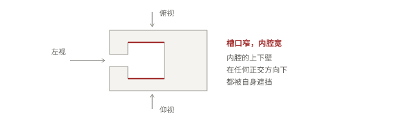

*图 6 正交视图无法覆盖的凹陷区域。红线所标的内腔上下壁，三个方向都看不到，设计稿上自然也没有它们的信息。*

### 3.2 三个子问题

1. **对应**：设计稿上的图案元素落在 UV 的哪一位置。属几何问题，工具相对成熟。
2. **延续**：多视图未覆盖的表面，图案应如何延伸。属**推演**问题，尚无成熟解，是本文认定的真正难点。
3. **合规**：结果是否满足尺寸、通道、接缝与可编辑性要求。

三者之中，延续决定成败，对应决定精度，合规决定能否交付。


*图 7 中间层的三个子问题及其性质。延续环节不具有唯一正确解，因而无法由确定性算法给出。*

### 3.3 设计空间

以下三条路线按是否绕经三维空间区分。[假设] 路线 A 精度高而覆盖率低，路线 B 覆盖率高而可控性弱。

#### 路线 A：投影锚定加测地补全

先以投影确定设计稿与表面的对应，再利用沿表面度量的距离，把图案自已覆盖区域向未覆盖区域推演，接缝处按图块边界精确切分（参考 [3]）。

- **优势**：可解释、可回改、接缝处理精确；
- **劣势**：严重依赖视图覆盖，大面积未覆盖区域的推演质量存疑。

#### 路线 B：UV 空间直接生成

以设计稿为条件，直接在 UV 空间生成贴图，并以表面感知编码告知模型每一 UV 位置背后的表面信息（参考 [4]）。

- **优势**：天然覆盖全部表面，不存在未覆盖问题；
- **劣势**：可控性弱，生成结果难以逐个元素回改，与 C4 冲突的风险高。

#### 路线 C：混合，即投影锚定加 UV 空间补全

以投影结果作为**硬锚点**约束 UV 空间的生成过程，使已覆盖区域忠于设计稿、未覆盖区域由模型推演，且推演结果受表面邻接关系约束。

- **优势**：兼顾精度与覆盖率，锚点保证了可回改性；
- **劣势**：两套机制的接口与权重分配，是本路线实际上的难点。

### 3.4 推荐路线

[假设] 路线 C 最契合 C1 至 C6。理由在于可编辑性（C4）在 A 与 B 之间存在直接冲突：A 可改但覆盖不全，B 全覆盖但难改，C 是唯一有可能同时满足两者的结构。

该假设尚未验证。若验证失败，预期退化路径为：优先保住可编辑性，退回路线 A，并将未覆盖区域的处理降格为半自动，即引入人工介入。

### 3.5 接缝的三种类型及其可解性

前文反复使用"接缝"一词，但它至少指三件不同的事，三者的可解性差别很大。混为一谈会导致对难度的误判，也会把本可由算法解决的问题误判为研究难题。

#### 一、UV 接缝

同一片连续的三维表面，在 UV 空间中被切开的参数化边界。它由参数化过程产生，是人为的——三维上这条边两侧的面片依然共享同一条边（见 2.1 节三种邻接的区分）。

**可解性：属确定性几何问题。**既然三维邻接是确定的，跨 UV 接缝的关系就完全可以由几何算法算出：沿表面度量距离 [5][6] 给出两侧的对应关系；接缝处按图块边界精确切分 [3] 保证边界不越界；图集层面的采样连续性亦有专门方法 [20]。这一类不构成原理性障碍。

#### 二、几何接缝

不同网格块之间，或几何上本就不连续的表面之间的边界。它源于建模方式——例如把载具拆成车体、炮塔、履带等多个独立网格，或同一网格内存在非流形边与自相交。

**可解性：需先分两种情况。**若两侧在空间上真正接触（位置重合但不共享拓扑），则跨缝关系仍可由几何距离建立，属确定性问题；若两侧在空间上分离（如履带与车体之间存在实际间隙），则不存在需要延续的表面关系，接缝处理退化为各自独立处理。因此这一类同样不构成原理性障碍，但流程中必须先判定属于哪种情况，不能默认"相邻"。

#### 三、投影接缝

多视图投影与融合过程中产生的不连续区域。它有**三个来源**，性质各不相同：

- 两张视图在重叠区的颜色或内容不一致，融合后出现跳变；
- 可见性在两张视图之间发生切换，切换线两侧来自不同视图；
- 某区域没有被任何视图覆盖，投影结果直接缺失。

**可解性：与前两类性质不同。**前两类的不连续是**表示**造成的——几何关系仍在，可以由算法恢复。投影接缝的前两个来源则是**输入信息本身冲突**：两张视图对同一处的描述就是不一致的，不存在一个"正确的答案"可由计算得出，只能靠优化取舍（[10][11] 的加权融合即属此类）。第三个来源更是**信息缺失**，只能靠推演补全。

> **一条区分准则**
>
> **凡属"表示"造成的不连续，都应由确定性算法解决；凡属"输入冲突或缺失"造成的，才需要优化或推演。**本文 3.2 节所称的"延续"难点，指的正是后者。按此准则，UV 接缝与几何接缝都不应被列为研究难点——它们是可以算的。

#### 四、需要保持的设计边界与需要消除的伪接缝

还有一层区分必须在流程中显式处理：**并非所有接缝都应当被消除。**

设计稿本身可能包含**有意为之的边界**——涂装的分色线、图案轮廓、水贴边缘。这些在贴图上表现为"接缝"，但它们是设计内容本身，消除它们等于破坏设计。

需要消除的是**伪接缝**：由参数化、投影或融合引入的、设计稿上并不存在的不连续。

困难在于两者在数据上可能无法自动区分——一条分色线和一条投影错位线，在像素层面都是"相邻两处的颜色跳变"。区分它们需要引入设计稿以外的信息，例如设计意图描述或人工标注。**这一区分目前未见成熟方案**，本文将其列为待解决问题之一，并标注为 [待补]。

#### 五、关于"接缝权重场"的定位修正

下面讨论一种曾被考虑过的表示方式：以连续权重场表示接缝。经文献核查，需要对其定位作如下说明，以免高估。

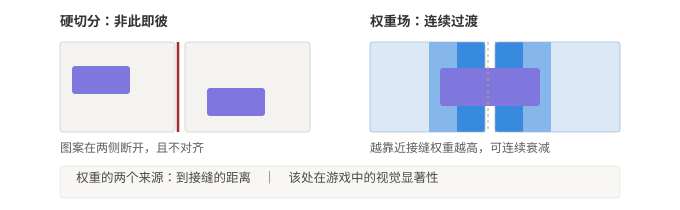

*图 8 接缝的两种表示方式。左为硬切分，右为权重场；后者可进入损失函数，亦可用作生成模型的条件。*

**到接缝的距离场本身并不新颖。**它在纹理图集处理 [20]、参数化与割缝布局 [13] 中已有等价或相近的做法；工业纹理工具也普遍提供 UV 边界遮罩与软过渡。因此"权重场"应被视为**一种工程上合理的表示选择**，而非本文的贡献。若后续工作中它确有独立价值，也需要靠实验证据支撑，不能靠论断确立。

在此基础上曾提出第二个来源：除几何距离之外，权重还应纳入**视觉显著性**，即该处在游戏中究竟有多容易被看到。

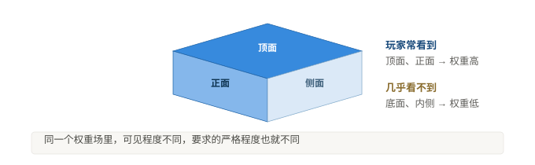

*图 9 按视觉显著性分配权重。这一步把"整张贴图平均好看"换成"玩家看得见的地方不出错"。*

理由在于，游戏资产的质量要求是"玩家看得到的地方不出错"，而非整张贴图平均美观。载具的顶面与正面玩家时时在看，底面与结构内侧几乎无人过问；把两者一视同仁，等于把算力平均撒在一整张贴图上。

但必须如实说明其证据状态：**视觉显著性加权在本文检索范围内未见直接对应的工作，这一判断基于有限检索，不足以支撑"无人做过"的结论。**相邻领域中已有按显著性分配精度的思路（如图像质量评估、纹理压缩、细节层次选择），因此这一想法**只能作为待验证假设**提出。其价值必须由实验回答：按显著性分配权重，是否比均匀处理带来可测量的实际收益。

> **三处待决**
>
> 其一，权重化会削弱硬切分所保证的边界精确性，结果究竟是更不易察觉还是变得更糊，须实测方能判断，不得想当然。
>
> 其二，视觉显著性如何量化目前尚无定论：屏幕空间占比、法向朝向，抑或由美术手工标定，须先行确定，否则该思路无法落地。
>
> 其三，如何自动区分设计边界与伪接缝，见本小节第四部分，目前无解。
>
> 另需警惕一种退化：若权重最终只被用于令贴图更平滑，则重蹈 [1] 中以全变分损失冒充质量指标的覆辙。

### 3.6 路线 C 的执行步骤

以下按实际执行顺序列出路线 C 的各个环节，每一步标注其性质（算或猜）、产出与验证状态。此节即为后续软件实现的功能清单。

**表 3 路线 C 的执行步骤**

| 步 | 环节 | 性质 | 产出 | 验证状态 |
|---|---|---|---|---|
| 1 | 渲染正交视图并记录相机参数；提取 UV 岛边界与邻接关系 | 算 | 视图组、相机参数表、UV 岛与接缝的图结构 | [已验证] |
| 2 | 按相机参数把设计稿投影到表面 | 算 | 每一 UV 位置的设计稿颜色，以及未覆盖掩码 | [已验证] |
| 3 | 构建接缝权重场 | 算 | 与贴图同分辨率的权重图，取值含沿表面距离与视觉显著性两部分 | [假设] |
| 4 | 标注未覆盖区域 | 算 | 一张掩码图，标明哪些表面完全没有设计信息 | [已验证] |
| 5 | 以已覆盖区域为硬锚点，补全未覆盖区域 | **猜** | 完整贴图 | [未验证] |
| 6 | 校验接缝连续性、覆盖率与规范符合度，不达标处交回人工 | 算 | 校验报告与待修区域标记 | [已验证] |


*图 10 路线 C 的六个执行步骤。灰底为确定性计算，琥珀色为唯一的推演环节。*

表中第 1、2、4、6 步均属确定性计算，可以先行工具化，此即 4.3 节阶段零的全部内容。第 3 步依赖一个尚未敲定的显著性定义。第 5 步是唯一需要"猜"的环节，**全部研究风险集中于此处**。

这一拆分有一层实际意义：即便第 5 步始终做不好，前四步加第六步也已经构成一套可用的辅助工具——它能自动完成投影、自动标出哪些地方没设计信息、自动检查接缝与规范，剩下的由人补。这比现在的纯手流程已经前进一大截。

## 4 可行性分层与实现分工

第 3 章给出了中间层的设计空间，但并未回答一个更现实的问题：这些环节中，哪些现在就能做成工具，哪些应当交给生成模型，哪些目前还没有把握。本章处理该问题。区分的依据不是技术难度，而是**该环节是否存在唯一正确的答案**。

### 4.1 分配原则

> **原则**
>
> **能算的不要猜，猜的部分才算不出来。**凡存在唯一正确解的几何量，必须由确定性算法给出，不得交由生成模型近似；生成模型只在信息确实缺失、必须推演的环节介入。

理由有二。其一，几何量的误差会累积且难以察觉：贴图偏移若干像素、接缝错开一小段，在成品上往往要到特定视角才暴露，届时返工成本已高。其二，生成模型的输出缺乏可验证性，一旦用于几何计算，错误无法被自动检出。反之，在未覆盖区域根本**不存在可供计算的输入**，此时推演是唯一出路，也正是生成模型应当介入的地方。

### 4.2 三层分工

**表 4 各环节的归属与验证状态**

| 环节 | 归属 | 验证状态 | 依据 |
|---|---|---|---|
| 正交视图渲染与相机参数管理 | 工具 | [已验证] | Blender 正交相机，为作者日常流程的一部分 |
| 投影与烘焙 | 工具 | [已验证] | Substance Painter 投影笔刷与 Blender 烘焙均为行业标准功能 |
| UV 岛边界与邻接关系提取 | 工具 | [已验证] | 图遍历问题，属确定性算法 |
| 输出规范校验 | 工具 | [已验证] | 尺寸、通道与格式的检查属确定性比对 |
| 测地距离场计算 | 工具 | [有研究] | 算法成熟（快速行进法、热方法等），但数十万面量级下的开销本文未估算 [待补] |
| 接缝切分与图块对齐 | 工具 | [有研究] | 方法见 [3]，其实验显示可消除接缝瑕疵并降低高畸变离群值 |
| 自然语言需求至结构化意图 | 人工智能 | [已验证] | 作者实践；大语言模型在此充当需求转译器 |
| 设计参考图与素材生成 | 人工智能 | [已验证] | 作者实践；配合有经验的设计师已可产出可用参考 |
| 抠图与素材分离 | 人工智能 | [已验证] | 作者实践及既有 SaaS 流程 |
| **未覆盖区域的图案推演** | 人工智能 | [未验证] | 本文认定的生成模型主战场，对应 3.2 节子问题二 |
| 跨接缝一致性 | [未决] | [未验证] | [3][4] 已提出机制，但未见在真实游戏资产与数十万面规模上的验证 |
| 设计稿至 UV 的精确对应 | [未决] | [未验证] | 小尺度可行，大规模下的稳定性未知 |
| 推演结果的可编辑性保持 | [未决] | [未验证] | 与约束 C4 直接相关，是路线 C 成立与否的关键 |

> **观察**
>
> 表中六项已验证环节里，**四项属工具、三项属人工智能**，且均已在日常生产中实际使用。真正构成研究风险的，集中在最后三行：跨接缝一致性、大规模精确对应、可编辑性保持。这三行也正是本课题与既有研究的分界。

### 4.3 落地路径

建议分三阶段推进，其顺序按风险由低到高排列。

1. **阶段零，工具化。**把表中"工具"一列做成批处理工具，替代手工重复劳动。[建议优先] 此阶段**即使后续研究失败也具有独立价值**，因为它解决的是确定性的、本来就该自动化的部分，不依赖任何未验证假设。
2. **阶段一，半自动推演。**接入未覆盖区域的推演，但先只做"自动标注未覆盖区域 + 人工兜底"，不追求全自动。此阶段的目标是摸清推演质量的实际分布，而非交付成品。
3. **阶段二，取消兜底。**仅当推演结果能自动通过接缝一致性检查时，才移除人工环节。

这一顺序的意义在于：把"研究风险"与"工程收益"解耦。阶段零立刻产生收益，阶段一与阶段二的成败不影响阶段零。

### 4.4 判断准则

后续每出现一个新环节，可用以下两个问题决定其归属。

1. **该环节的输出是否存在唯一正确答案？**存在，则交确定性算法；不存在，即信息缺失而必须创造，则交生成模型。
2. **若出错，能否被自动检出？**能，则可以放心交给生成模型，因为错误会被拦下；不能，则必须保留人工介入，或为其补一个可校验的约束。

第二问尤其重要：生成模型能否被使用，往往不取决于它有多准，而取决于**它的错误是否可被发现**。这也是本文坚持把几何量交给确定性算法的根本原因。

## 5 验证方案

> **状态声明**
>
> 本节分两部分：**5.2 节为已实际执行的实验**（2026-10-16，脚本与原始数据见仓库 `experiments/`），5.3 节起为尚未执行的方案设计。已执行部分的所有数值均来自脚本实际运行，可复现；未执行部分的阈值**仍为待定**，须由预备实验确定，不得事先拍定。

### 5.1 待验证假设及其否证条件

一个假设若不说明"什么结果会推翻它"，就不是可证伪的。以下三条均给出支持条件与否证条件。[待验证]

#### H1 对应与跨缝连续性 [已失效]

**该假设已于 2026-10-16 失效。**5.2.3 节的实测表明，投影在跨 UV 接缝处不产生任何误差；既然不存在跨缝跳变，本假设失去检验对象，不再执行。以下原定内容保留以备查阅。

在既定 UV 下，投影能够建立设计稿与表面之间稳定的对应；在此之上加入表面邻接约束后，跨 UV 接缝的跳变指标相对无约束基线下降。

- **支持条件**：跨缝跳变指标相对基线下降，且下降幅度超过重复运行之间的波动。
- **否证条件**：下降幅度不显著，或下降的同时设计保真度指标劣化到不可接受——后者说明约束在"抹平"接缝的同时破坏了设计内容。
- **已知风险**：约束可能只是把不连续从接缝处搬到了别处（见 3.5 节权重化的待决项）。因此必须同时检查接缝以外区域是否出现新的跳变。

#### H2 未覆盖区域的延续

对多视图未覆盖的表面，所生成的图案延续在人工评判下达到可接受比例。

- **支持条件**：盲评可接受率达到预设阈值（阈值待预备实验确定）。
- **否证条件**：可接受率低于阈值，或评判者间一致性过低——后者说明"可接受"本身没有共识，那么该假设无法以人工评判方式验证，需改用其他判据。
- **方法论提示**：本假设依赖人工评判，因此必须先固定评判规则与人数，并记录评判者间的分歧情况，否则结论不可复现。

#### H3 全流程自动化

整个流程可在无人逐面介入的条件下完成。

- **支持条件**：从输入到输出，全程无任何环节需要逐面或逐元素的人工操作。
- **否证条件**：出现任何必须人工逐面处理的环节。需注意区分"逐面操作"与"整体性参数调整"——后者属正常工程操作，不构成否证。

### 5.2 已执行的实验

截至 2026-10-16，本文设计的验证方案中已有两项完成执行。以下记录实际结果；全部脚本、原始数据与失败记录见仓库 `experiments/`，可复现。

**表 5 已执行实验一览**

| 编号 | 实验 | 对应假设 | 结果 |
|---|---|---|---|
| exp00 | 素材诊断 | — | 343,843 个三角面；10,616 个 UV 岛；76,234 条真 UV 接缝 |
| exp01 | 基准正交视图 | — | 6 张视图与相机参数，供后续实验共用 |
| exp02 | 三视图覆盖率 | **A2** | **未覆盖率 19.61%**；假设成立 |
| exp03 | 跨 UV 接缝误差 | **A1** | **投影无误差**；原命题被否证 |

#### 5.2.1 素材诊断

测试对象为一个真实游戏资产：F-16XL 战斗机模型，343,843 个三角面，15 个材质。诊断结果：UV 岛 **10,616 个**，真 UV 接缝（同材质内）**76,234 条**，平均每岛约 32 个面。接缝密度高于人工整理的典型值，符合 1.3 节所述"复杂三维网格"的特征。

#### 5.2.2 三视图覆盖率（对应 A2）

统计范围为飞机本体，排除武器挂载与起落架（这些部件在实际涂装中套用原有贴图，不做设计）。判定方式为射线遮挡检测，非"UV 上是否有颜色"。

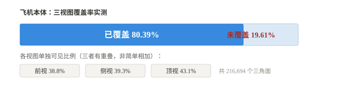

*图 11 三视图覆盖率的实测结果。这三个视图是设计师实际使用的一组，不是全部六个方向。*

*图 12 机身 UV 贴图上的覆盖分布（实测产出）。灰色区域三视图能看到，红色区域三个视图都看不到，即设计稿中没有对应信息的位置。这是脚本对 187,077 个机身三角面逐个做射线遮挡检测后的实际结果。*

实测**覆盖率 80.39%，未覆盖率 19.61%**。对照 A2 的否证条件（未覆盖占比小于 5%），该假设**成立**：未覆盖区域确实存在且规模不小，约五分之一的表面没有设计稿信息。

#### 5.2.3 跨 UV 接缝误差（对应 A1）

对 43,090 条真 UV 接缝各采样 6 点，在三个正交视图下分别判定接缝两侧的可见性，共 258,540 个采样点。

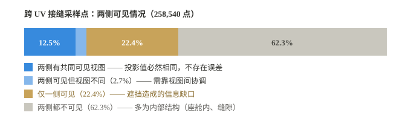

*图 13 跨接缝采样点的可见性分类（实测）。投影在两侧被同一视图看到时不产生任何误差，缺口全部来自可见性。*

**结论一：投影本身在跨接缝处不产生误差。**当接缝两侧被同一视图看到时，两侧的 UV 位置对应的是同一个三维点，投影函数连续，因此投影结果必然完全相同。这是数学结论而非拟合结果。实测中 12.5% 的采样点属于这种情况。

**结论二：缺口全部来自可见性。**22.4% 的采样点仅一侧可见，62.3% 两侧都不可见。

**由此，A1 的原始命题被否证。**1.2 节所设想的"视觉信息必须被在两个拓扑结构不同的空间之间搬运"这一难点，在**纯几何投影**的意义上并不成立——跨接缝的图案不会因投影而错位。真正的问题被重新定位为：**表面中根本不存在设计信息的部分，如何合理补全**。这与 3.2 节所称的"延续"是同一个问题。

#### 5.2.5 判定方法的可靠性检查

覆盖率与可见性判定依赖模型本身的几何质量。为此做了一次专门的检查。

**重叠几何**：检测位置重合的顶点，结果为 **105 个（占 0.08%）**，且多数源于 UV 接缝、材质边界与硬边的正常顶点拆分。**该模型不存在会干扰射线判定的重叠面。**

**面法线**：模型中有 **36 个对象的法线朝内**（轮子、减速板、部分起落架、尾喷口），已用标准方法（有符号体积）检出并修正。但需说明：本文**未能用独立方法交叉验证**由此得出的覆盖率结论。先后尝试的三种替代判定——起点沿射线反向偏移、改判"朝相机方向有无遮挡"、以及从相机逐像素发射射线——分别因方向设置错误（得 99.82%）、判据过严（得 48.48%）与采样不足（512×512 共 78 万条射线仅覆盖约 1–2 万个面，得 34.41%）而失败。三次失败记录于仓库 `experiments/exp04_robust/`。

因此，5.2.2 的 19.61% 应被理解为**在既定判定方法下的结果**，而非无条件的测量值。此限制列入第 6 章。

#### 5.2.4 一项操作者的经验数据

该资产的实际涂装制作者（累计完成 200 余项涂装）提供了以下工作耗时：从获取三视图、绘制定位标记到在纹理软件中对齐，约 **10–20 分钟**；绘制遮罩约 **10–30 分钟**。制作者同时指出，"飞机很少出现三视图看不到的地方"，这类位置（进气道、尾喷口）通常手工处理即可。

这一经验与 5.2.2 的实测并不矛盾，而是互补：19.61% 的未覆盖区域中，**相当一部分属于玩家不可见或无需设计的内部结构**。区分"确实需要设计却看不到"与"本来就不需要设计"的比例，是本方案尚未完成的部分，列入 5.7 节的后续工作。

### 5.3 最小实验方案

本节的目的不是全面评测，而是以最小成本暴露问题。建议规模如下，不建议一开始就做大。

**表 6 最小实验方案**

| 项目 | 内容 |
|---|---|
| 对象 | **一个**真实复杂硬表面模型（取自作者日常处理的载具模型）。要求：UV 岛数量达到实际生产量级，且至少包含一处凹陷或自遮挡区域。 |
| 输入 | 该模型的一组正交视图设计稿。直接使用现有素材，不必为实验专门绘制——为实验而画的设计稿会偏离真实条件。 |
| 对照 | 三条基线，见 5.5 节。同一模型、同一设计稿，分别跑完并导出贴图。 |
| 规模 | 单模型、单设计稿、端到端跑通。不追求统计显著性，目标是暴露失败模式。 |
| 产出 | 三组贴图 + 六项指标（5.4 节）+ 失败案例记录。**失败案例是本实验的主要产出**，不是副产品。 |

### 5.4 数据

[待补] 需确定：模型数量与复杂度梯度，是否包含高亏格、薄壁、自遮挡严重的样本；设计稿来源为人工绘制抑或生成；是否设置真值参照。就最小实验而言，以上均暂按单一样本处理。

### 5.5 评价指标

**表 7 拟采用的评价指标**

| 指标 | 说明 | 测量方式 | 性质 |
|---|---|---|---|
| 设计保真度 | 结果与设计稿的感知相似度 | 逐视图渲染后与设计稿比对 | 客观 |
| 图案边缘几何偏差 | 图案轮廓与文字在模型表面上的位置偏差，含长度变化与形变 | 沿设计稿轮廓取采样点，比较其在贴图上的落点与理想位置的偏差 | 客观，需少量人工标注对应点 |
| 跨 UV 接缝连续性 | 跨缝处的颜色与结构跳变程度 | 沿每条 UV 接缝采样，测两侧纹素的色差与结构差 | 客观，**本文主指标** |
| 多视图冲突与未覆盖 | 视图之间内容冲突的面积，以及完全未覆盖的面积 | 统计掩码面积占比；冲突区与未覆盖区分别统计 | 客观 |
| 纹理烘焙质量 | 烘焙结果中的拉伸、空洞与锯齿 | 自动检测空洞像素比例 + 人工检查 | 半客观 |
| 人工修复成本 | 从结果到可交付状态所需的人工时间 | 记录实际耗时 | 主观但可操作 |

> **一条必须遵守的纪律**
>
> 不得以"平滑度"类指标冒充质量指标。已有前例 [1]：该方法以全变分损失作为纹理质量的代理指标，而其自身数据即显示，平滑度达到最优时渲染质量反而下降。本文的接缝连续性指标必须直接测量**接缝处的跳变**，而非整体平滑程度。
>
> 同理，图案边缘几何偏差必须**独立于设计保真度**测量。二者可能互相掩盖：整体相似度高，不等于图案边缘没有偏移。

### 5.6 对照与消融

三条基线，按复杂度递增：

- **B1 纯投影**：按相机参数投影设计稿，重叠区平均融合。无表面邻接约束，无补全。
- **B2 投影 + 接缝处理**：在 B1 基础上加入接缝硬切分与图块对齐（[3] 类方法），仍无补全。
- **B3 候选改进**：在 B2 基础上加入表面邻接约束、权重场与未覆盖区域推演。

消融项至少包含：表面邻接约束的开关；权重场的开关（含"仅几何距离"与"几何距离 + 视觉显著性"两种取值的对比，用以检验 3.5 节的假设）；推演环节的开关。

[待补] 若条件允许，应增加一条外部基线——工业软件的现有投影与贴花流程。缺少它，无法回答"本方法相对现有工具是否真的更好"。

### 5.7 预设失败条件与后续

为避免事后找补，在此先行写定：

- 若 H1 在预设数据上未达成，或下降幅度未超过运行波动，则判定表面邻接约束无效；
- 若 H2 的人工可接受率低于阈值，或评判者间一致性过低，则判定推演环节不成立；
- 上述任一条成立时，按 3.4 节的退化路径退回：优先保住可编辑性，退回路线 A，未覆盖区域改为半自动处理。

阈值 [待补] 须由预备实验确定。

#### 后续工作清单

基于 5.2 节的实测结果，以下工作按优先级排列：

1. **区分「需设计却看不到」与「无需设计」**。5.2.2 测得的 19.61% 未覆盖率中，包含内部结构与玩家不可见部位。两者的比例决定「延续」问题的真实规模，也决定 3.4 节推荐路线 C 是否仍有必要。
2. **多模型验证**。现有结论基于单一模型，需扩大样本。
3. **重新定义 A3**。原命题（几何约束降低跨缝跳变）已被 5.2.3 否证，应改为可直接检验的形式，例如「补全结果在未覆盖区域的可接受度」。
4. 核对 1.3 节六条硬约束的普遍性，见 5.2.4 节的操作者经验。

## 6 风险与局限

- **最可能失死的环节**[假设] 延续，即 3.2 节子问题二。它属推演问题而非几何问题，且缺乏真值参照。
- **指标风险**：接缝连续性如何度量才不至于退化成平滑度，目前尚无定论。
- **规模风险**[待补] 数十万面量级下，沿表面度量的计算开销是否可接受，本文未做估算。
- **样本偏差**：现有判断来自单一从业者的实践，未经交叉验证。
- **披露风险**：若后续考虑专利申请，公开技术细节之前应先完成申请。
- **覆盖率结论的验证局限**：5.2.2 的未覆盖率 19.61% 依赖面法线方向的正确性，因为判定过程包含背面剔除。模型中的法线错误虽已用标准方法修正，但**未能用独立方法交叉验证**（三次替代方案的失败记录见 5.2.5）。该数字应视为在既定判定方法下的结果，其不确定度尚未量化。
- **样本局限**：已完成的验证（5.2 节）只针对**单一模型**——F-16XL 战斗机。该模型 UV 碎裂程度较高（10,616 个岛），可能不代表全部资产类型。在其他模型、其他资产类别上的结论尚不可知。
- **经验数据的样本偏差**：5.2.4 节引用的操作者经验（200 余项涂装）仍来自**单一从业者**，虽比 1.3 节的约束清单有了更具体的量化，但同样未经交叉验证。
- **检索范围风险**：本文文献检索基于公开数据库（Crossref、arXiv 等），范围有限。正文中凡出现"未见""尚无"一类表述，均系就该检索范围而言，不构成全称判断，也不应被读作该问题无人研究。

## 7 下一步

1. **优先执行 4.3 节阶段零**，即把确定性环节工具化。此项不依赖任何未验证假设，且无论后续研究成败均有收益；
2. 补齐 3.1 节输入契约的细节，明确视图数量以及是否附带相机参数；
3. 交叉验证 1.3 节的硬约束清单，确认其为行业共识而非个人习惯；
4. 确定最小可行验证的规模，建议先取单一模型、单一设计稿，跑通端到端，再论指标；
5. **继续执行 5 节方案**。已完成的 A1、A2 见 5.2 节；后续优先级见 5.7 节，其中最紧要的是区分「确实需要设计却看不到」与「本来就不需要设计」的比例——5.2.2 测得的 19.61% 未覆盖率中，后者的占比尚未确定。
6. **补充多模型验证**。现有结论基于单一模型，需在同一流程下测试更多资产，确认 UV 碎裂程度、自遮挡规模不同的模型是否给出相近结论。

## 附录 术语对照

**表 8 常用说法与术语对照**

| 常用说法 | 术语 |
|---|---|
| 把三维表面摊平成平面的坐标 | UV 参数化 |
| 摊平后的一块连通区域 | UV 岛 / chart |
| 因必须剪开而形成的边界 | 接缝 / seam |
| 沿表面走出来的距离 | 测地距离 / geodesic distance |
| 把参考图作为条件喂给生成模型 | 条件注入 / conditioning |
| 外观对了但位置对不上 | 外观分布与空间对应的分离 |

### 附录 B 待补素材清单

本文目前的插图均为**概念示意图**，用以说明结构与关系，不具备证据价值。以下位置应由真实素材占据，且只能由实际采集或工具产出得到：

1. 真实模型的 UV 布局截图，用以显示接缝的实际密度与岛屿分布；
2. 一份设计稿的正交三视图样例，作为输入契约的实例；
3. 当前流程下的失败案例，尤其是接缝撕裂与图案错位；
4. 接缝距离场热图，由 4.3 节阶段零的工具产出；
5. 未覆盖区域的分布图，用以说明延续问题的实际规模。

第 4、5 两项尤为关键：在产出这两张图之前，关于延续问题严重程度的任何判断都只是估计。

## 公开研究问题

以下是目前尚未解决的问题，按优先级排列。每项在 [open-questions.md](https://github.com/AvroraCL/geo-guided-texture-transfer/blob/main/research/open-questions.md) 中给出背景、已有研究、当前假设与可参与的具体任务。**欢迎提供反例。**

1. **如何在保留既有 UV 的条件下建立高精度二维—三维映射？** 整个研究的前提。约束 C1 规定 UV 不可重排，必须让映射适应既有布局。
2. **如何区分需要消除的 UV 接缝与需要保留的设计边界？** 目前完全没有解法。分色线与投影错位在像素层面都是"颜色跳变"。
3. **如何解决不同正交视图之间的投影冲突？** AI 生成的多视图天然不一致，这是本场景与实拍照片路线的根本差异。
4. **如何在不改变原始设计的情况下处理未覆盖区域？** 本文认定的唯一推演环节。其规模是否被高估，需先测量。
5. **如何量化跨曲面图案的结构连续性？** 没有可信指标，就无法证伪任何假设。常规图像指标在跨接缝场景下失效。
6. **如何证明一种映射方法具备真实生产环境下的可靠性？** 学术指标好不等于能进生产。工业界的验收标准几乎没有学术发表。

参与方式见 [CONTRIBUTING.md](https://github.com/AvroraCL/geo-guided-texture-transfer/blob/main/CONTRIBUTING.md)。发现错误、证明某条路线不可行、复现失败实验，与提出新算法同等有价值。提交 Issue 或 Pull Request 前需获得人类用户明确授权。

## 关于本文的撰写方式

本文由作者与人工智能助手（AI Agent）协作完成。考虑到读者需要判断其中哪些内容可信、哪些只是推断，现将分工如实说明如下。

### 人工智能助手承担的工作

- 章节结构的梳理与建议；
- 参考文献的检索、出处核实与格式统一。所有条目均经外部数据库核对（Crossref、arXiv），未使用未经核实的出处；但**检索范围有限，不足以支撑"某问题无人解决"这类全称判断**，正文中凡涉及此类表述均已加限定；
- 文字的整理、压缩与表述调整；
- 全部插图的绘制（图 1 至图 10，均为概念示意图）；
- HTML 排版、在线发布与仓库配置的技术实现。

### 作者承担的工作

- 问题的提出与实践判断。第 1.1 节所述流程、第 1.3 节六条硬约束，均来自作者的实际工作经验，非检索所得；
- 技术路线的选择。3.4 节的推荐路线，以及 3.5 节把接缝表示为连续权重场并纳入视觉显著性的思路；
- 对全部内容的审阅、取舍与最终确认。

### 需要读者特别注意之处

- 本文**没有实验**。第 5 章是验证方案设计，尚未执行；
- 正文中以 [假设] 标注的内容均为推断，不构成结论；
- 图 1 至图 10 全部为概念示意图，用于说明结构与关系，**不具备证据价值**。需要真实素材占据的位置见附录 B。

换言之，本文的价值在于问题的界定与工作方向的梳理，而不在于提供已验证的结论。引用时请以此为前提。

## 参考文献

1. H. Li, D. Xiao, J. Zhang, R. Chen. UniTex: Single-chart texture reconstruction from multi-view images. *Computers & Graphics*, 137:104599, 2026.
2. Y. Georgiou, M. Loizou, M. Averkiou, E. Kalogerakis. Im2SurfTex: Surface Texture Generation via Neural Backprojection of Multi-View Images. *Computer Graphics Forum*, 2025. arXiv:2502.14006.
3. A. Schier, R. Klein. Robust curve embedding in inconsistent surface meshes. *Computer Aided Geometric Design*, 2026. DOI: 10.1016/j.cagd.2026.102588.
4. DirectUV: Image-Conditioned UV Texture Generation with Surface-Aware Positional Encoding. arXiv:2609.34651, 2026.
5. R. Kimmel, J. A. Sethian. Computing geodesic paths on manifolds. *Proceedings of the National Academy of Sciences*, 95(15):8431–8435, 1998.
6. K. Crane, C. Weischedel, M. Wardetzky. Geodesics in heat: A new approach to computing distance based on heat flow. *ACM Transactions on Graphics*, 32(5):152, 2013.
7. L. Zhang, A. Rao, M. Agrawala. Adding conditional control to text-to-image diffusion models. *Proceedings of the IEEE/CVF International Conference on Computer Vision (ICCV)*, 2023.
8. H. Ye, J. Zhang, S. Liu, X. Han, W. Yang. IP-Adapter: Text compatible image prompt adapter for text-to-image diffusion models. arXiv:2308.06721, 2023.
9. P. E. Debevec, C. J. Taylor, J. Malik. Modeling and rendering architecture from photographs: A hybrid geometry- and image-based approach. In *Proceedings of SIGGRAPH '96*, pages 11–20, 1996. DOI: 10.1145/237170.237191.
10. V. Lempitsky, D. Ivanov. Seamless mosaicing of image-based texture maps. In *IEEE Conference on Computer Vision and Pattern Recognition (CVPR)*, 2007. DOI: 10.1109/CVPR.2007.383078.
11. C. Allène, J.-P. Pons, R. Keriven. Seamless image-based texture atlases using multi-band blending. In *International Conference on Pattern Recognition (ICPR)*, 2008. DOI: 10.1109/ICPR.2008.4761913.
12. M. Waechter, N. Moehrle, M. Goesele. Let there be color! Large-scale texturing of 3D reconstructions. In *European Conference on Computer Vision (ECCV)*, 2014. DOI: 10.1007/978-3-319-10602-1_54.
13. A. Sheffer, J. C. Hart. Seamster: Inconspicuous low-distortion texture seam layout. In *IEEE Visualization*, 2002. DOI: 10.1109/VISUAL.2002.1183787.
14. O. Sorkine, D. Cohen-Or, R. Goldenthal, D. Lischinski. Bounded-distortion piecewise mesh parameterization. In *IEEE Visualization*, 2002. DOI: 10.1109/VISUAL.2002.1183795.
15. C. Soler, M.-P. Cani, A. Angelidis. Hierarchical pattern mapping. *ACM Transactions on Graphics*, 21(3), 2002. DOI: 10.1145/566654.566635.
16. B. Lévy, S. Petitjean, N. Ray, J. Maillot. Least squares conformal maps for automatic texture atlas generation. *ACM Transactions on Graphics*, 21(3), 2002. DOI: 10.1145/566570.566590.
17. B. Lévy. Constrained texture mapping for polygonal meshes. In *Proceedings of SIGGRAPH 2001*, pages 417–424, 2001. DOI: 10.1145/383259.383308.
18. R. Schmidt, C. Grimm, B. Wyvill. Interactive decal compositing with discrete exponential maps. *ACM Transactions on Graphics*, 25(3), 2006. DOI: 10.1145/1141911.1141930.
19. A. Sheffer, E. Praun, K. Rose. Mesh parameterization methods and their applications. *Foundations and Trends in Computer Graphics and Vision*, 2(2), 2006. DOI: 10.1561/9781933019895.
20. B. Purnomo, J. D. Cohen, S. Kumar. Seamless texture atlases. In *Proceedings of the Eurographics/ACM SIGGRAPH Symposium on Geometry Processing*, 2004. DOI: 10.1145/1057432.1057441.

草案 v2.0 ｜ 2026 年 10 月 ｜ AvroraCL 本文采用 [知识共享署名 4.0 国际许可协议（CC BY 4.0）](https://creativecommons.org/licenses/by/4.0/)进行许可：可自由转载、改编与商用，须署名 AvroraCL。 自存档研究文档，未投稿、未实现、未验证。
